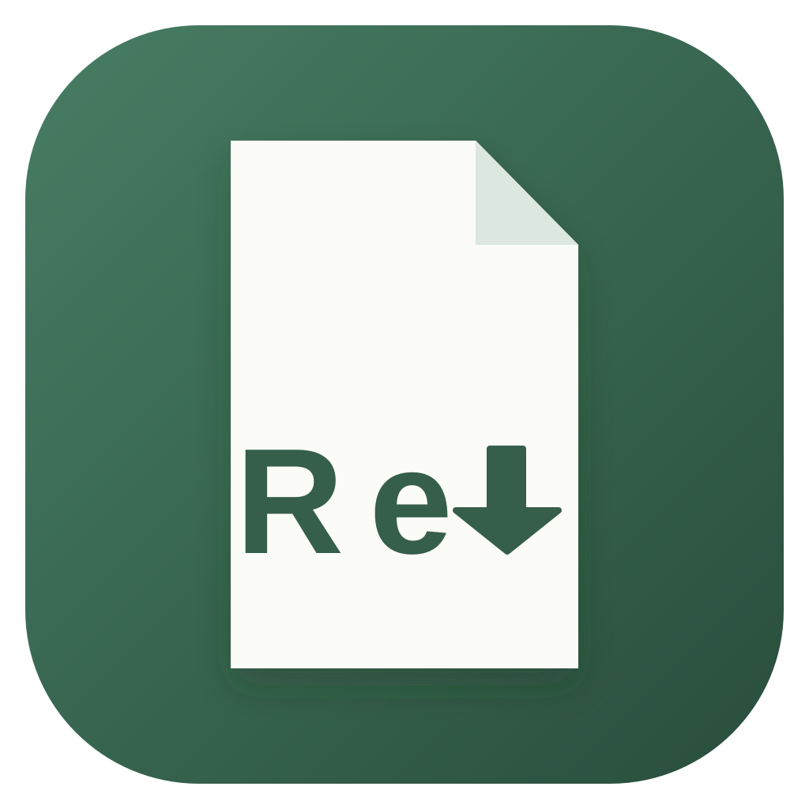
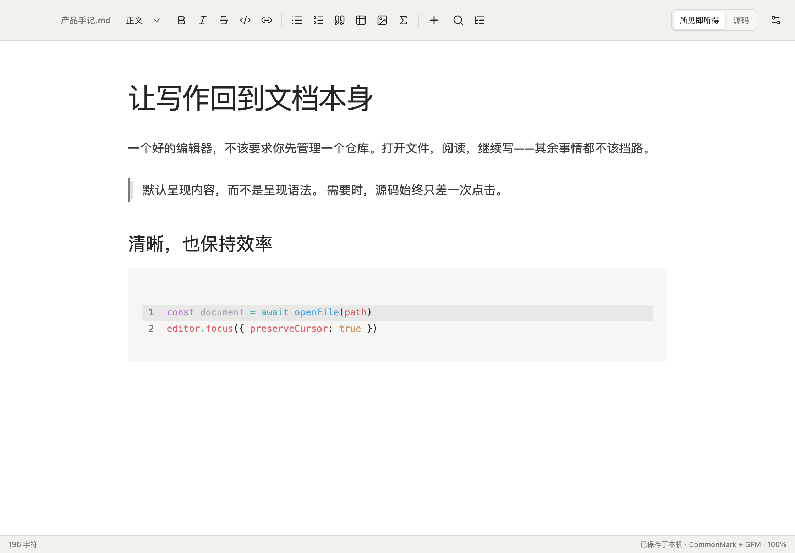
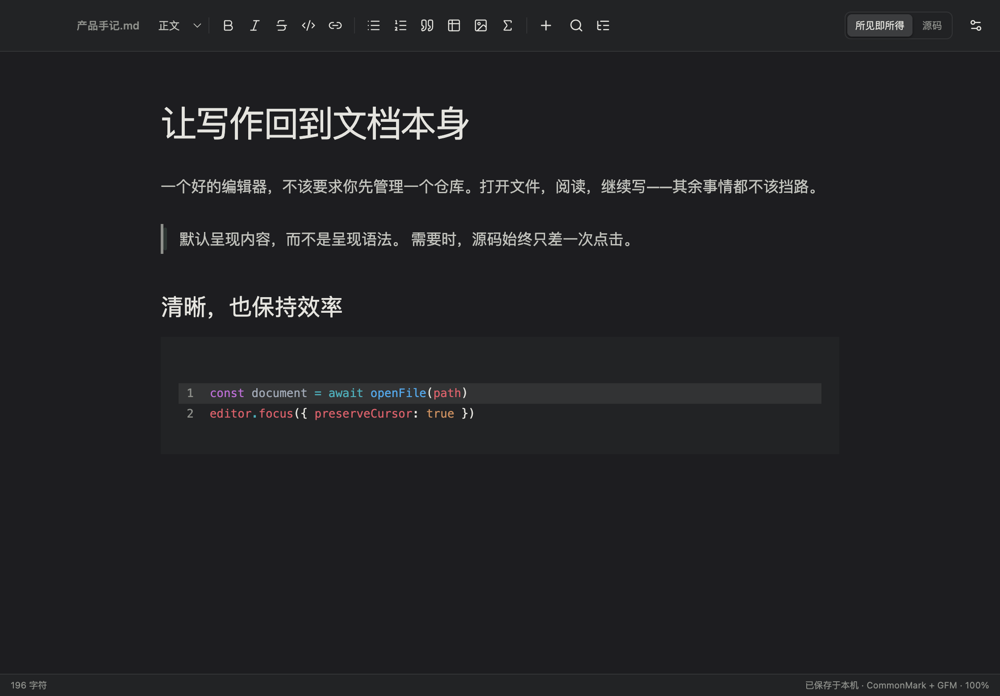

<p align="center">
  
</p>

<h1 align="center">Remark</h1>

<p align="center">
  <strong>A document-first Markdown reader and editor for macOS</strong><br>
  Open a file. Start writing. Nothing in the way.
</p>

<p align="center">
  <strong>English</strong> · <a href="Readme.zh-CN.md">简体中文</a>
</p>

Remark opens local Markdown files directly—no vaults, workspace imports, accounts, or file manager. Its default view is a true WYSIWYG editor, with a full source editor one click away.

| Native light | Native dark |
| --- | --- |
|  |  |

## Download

**Requirement:** macOS 13 Ventura or later.

Choose the installer that matches your Mac. To check, choose **Apple menu  > About This Mac** and look at **Chip**.

| Your Mac | Installer |
| --- | --- |
| Apple Silicon (M1 or later) | [Download Remark for Apple Silicon](https://github.com/RenQilei/ReMark/releases/download/v0.1.0-alpha.1/Remark-0.1.0-alpha.1-unsigned-arm64.dmg) |
| Intel | [Download Remark for Intel](https://github.com/RenQilei/ReMark/releases/download/v0.1.0-alpha.1/Remark-0.1.0-alpha.1-unsigned-x64.dmg) |

1. Open the DMG file from the matching download link above.
2. Drag **Remark** into **Applications**.
3. Launch Remark and open a `.md`, `.markdown`, `.mdown`, or `.mkd` file.

For Gitee, use the [Gitee Releases page](https://gitee.com/renqilei/remark/releases). Direct file links there work only after the Gitee Release and its assets have been published; use the GitHub links above meanwhile.

> **Prerelease status:** Current builds use ad-hoc signing and are not signed with an Apple Developer ID or notarized. Review the release notes and verify the checksum before installing. Do not disable Gatekeeper or lower your system security settings. Signed and notarized stable builds will use different release notes.

### Verify your download

Download [SHA256SUMS.txt](https://github.com/RenQilei/ReMark/releases/download/v0.1.0-alpha.1/SHA256SUMS.txt), place it in the same directory as the DMG, then run:

```bash
shasum -a 256 -c SHA256SUMS.txt
```

Every entry should end with `OK`.

## Quick start

- **Open a document:** Use `⌘O`, Finder, Dock drop, or drag a file onto Remark.
- **Edit visually:** Headings, lists, quotes, tables, code, formulas, and other content are rendered instead of showing their Markdown markers.
- **Switch to source:** Choose **源码 / Source** to edit the exact Markdown text. Unsaved content follows you between modes.
- **Save:** Press `⌘S`. Use `⇧⌘S` for Save As. Manual save is the default; automatic save is optional.
- **Work with multiple files:** Files open in native macOS tabs by default. Use the Window menu or native tab gestures to move a tab into its own window or merge windows.

| Action | Shortcut |
| --- | --- |
| New document | `⌘N` |
| New tab | `⌘T` |
| Open file | `⌘O` |
| Save | `⌘S` |
| Save As | `⇧⌘S` |
| Find and replace | `⌘F` |
| Undo | `⌘Z` |
| Redo | `⇧⌘Z` |
| Settings | `⌘,` |

## Features

### Documents without the overhead

- WYSIWYG and source editing with consistent unsaved content and cross-mode undo checkpoints.
- Native macOS tabs, independent windows, recent files, and duplicate-file focusing.
- Find and replace within the current document, plus a heading outline.
- Manual save, optional autosave, close protection, crash recovery, and external-change conflict handling.

### Technical Markdown

- CommonMark and GFM, including tables, task lists, strikethrough, and code highlighting.
- Footnotes and KaTeX inline/block math.
- Mermaid diagrams with editable source available in source mode.
- Sanitized raw HTML previews that preserve the original markup.
- Local and remote images, relative paths, and image import into a document's `assets` directory.

### A workspace that adapts to you

- Native, GitHub, Solarized, and Nord themes, each with light and dark variants.
- System-following, fixed-light, or fixed-dark appearance.
- Adjustable font, font size, content width, line height, and status bar.
- Configurable default editor mode and tab/window behavior.

## Privacy and document safety

Remark does not require an account and includes no analytics or telemetry. Your documents remain local unless you open remote content or links, which may contact external servers.

- **Atomic saves:** Changes are written to a temporary file beside the document and renamed only after a successful write.
- **Conflict protection:** If another app changes the file, Remark does not silently overwrite either version.
- **Recovery snapshots:** Unsaved content is stored in the app's local Application Support recovery directory and removed after a successful save or clean close.
- **Controlled resources:** Relative images cannot escape the document directory. Absolute image paths require an explicit user selection.
- **Untrusted markup:** Raw HTML is sanitized. Mermaid runs in strict mode and its SVG is sanitized; document scripts do not execute.

See [SECURITY.md](SECURITY.md) for the security model and vulnerability reporting.

## Build from source

**Requirements:** macOS 13+, Node.js 24+, npm, and Xcode Command Line Tools. A full Xcode installation is not required.

```bash
npm ci
npm run dev
```

Run the standard checks:

```bash
npm run typecheck
npm run lint
npm test
npm run test:e2e
npm run build
```

Build installers and verify the packaged app:

```bash
npm run dist:mac:unsigned   # Apple Silicon
npm run dist:mac:x64        # Intel
npm run smoke:packaged      # Open, edit, and save in the packaged arm64 app
npm run checksums
```

Installers are written to `release/`. See [docs/RELEASING.md](docs/RELEASING.md) for signing, notarization, and publishing instructions.

### Technical overview

Remark uses Electron, React, and TypeScript. Milkdown/ProseMirror powers visual editing, CodeMirror 6 powers source editing, and a shared `DocumentSession` owns the unsaved Markdown buffer, dirty state, and mode-switch history. Renderer access to files and native resources goes through a sandboxed, typed IPC layer.

## Project status and limitations

Remark is in early development. Please evaluate it on copies of important documents.

- Current DMGs are unsigned prereleases; Apple notarization and stable Gatekeeper validation are not complete.
- Visual editing may normalize some Markdown formatting. Unknown HTML and extension syntax are preserved through opaque nodes, but byte-for-byte source preservation is not guaranteed after a visual edit.
- `@milkdown/plugin-diagram` is deprecated upstream. It is pinned and covered by Mermaid rendering tests; replacing it with a maintained adapter is a maintenance priority.
- Split view, cloud sync, collaboration, a plugin system, AI features, custom theme files, automatic updates, and Mac App Store distribution are not included in this release.
- This release targets macOS only. Windows and Linux installers are not currently provided.
- The current app interface is Simplified Chinese. English UI localization is planned; the English documentation does not imply an English interface.

## Documentation and license

- [Contributing](CONTRIBUTING.md) · [中文贡献指南](CONTRIBUTING.zh-CN.md)
- [Security](SECURITY.md) · [中文安全说明](SECURITY.zh-CN.md)
- [Maintainer release guide](docs/RELEASING.md)
- [Changelog](CHANGELOG.md)
- [Third-party notices](NOTICE.md)

Remark is licensed under the [GNU General Public License v3.0](LICENSE).
