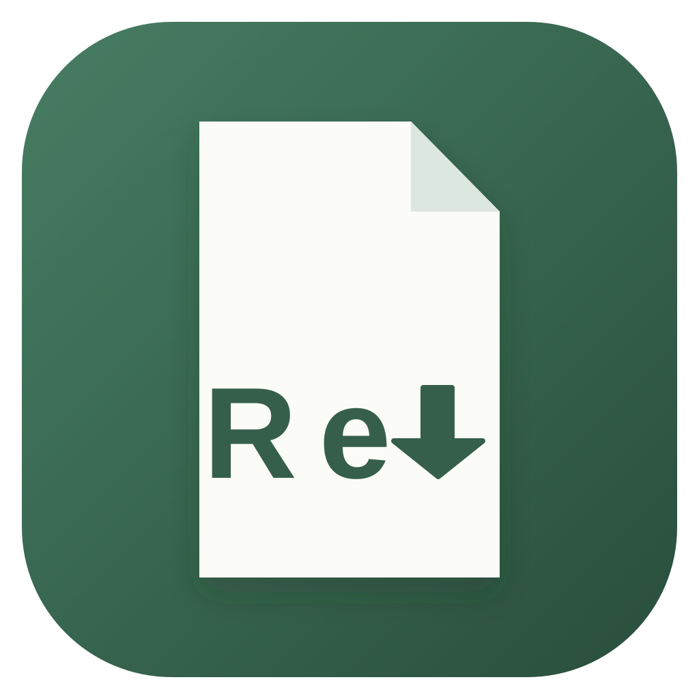
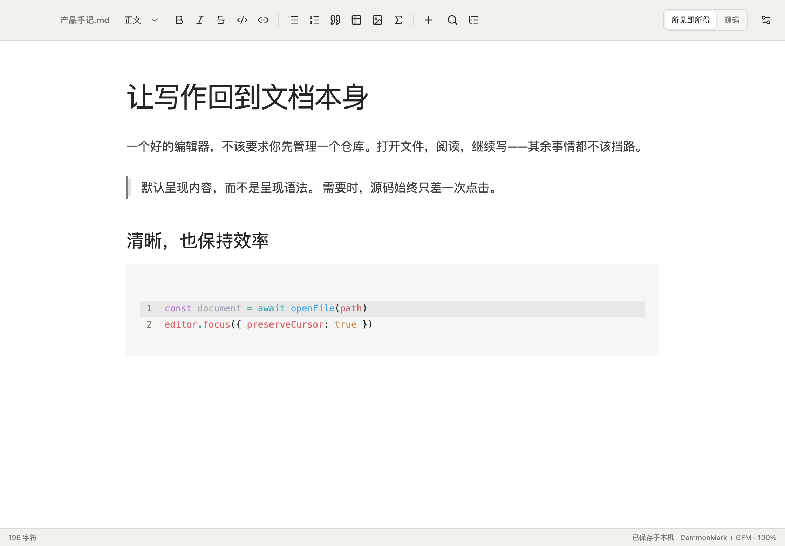
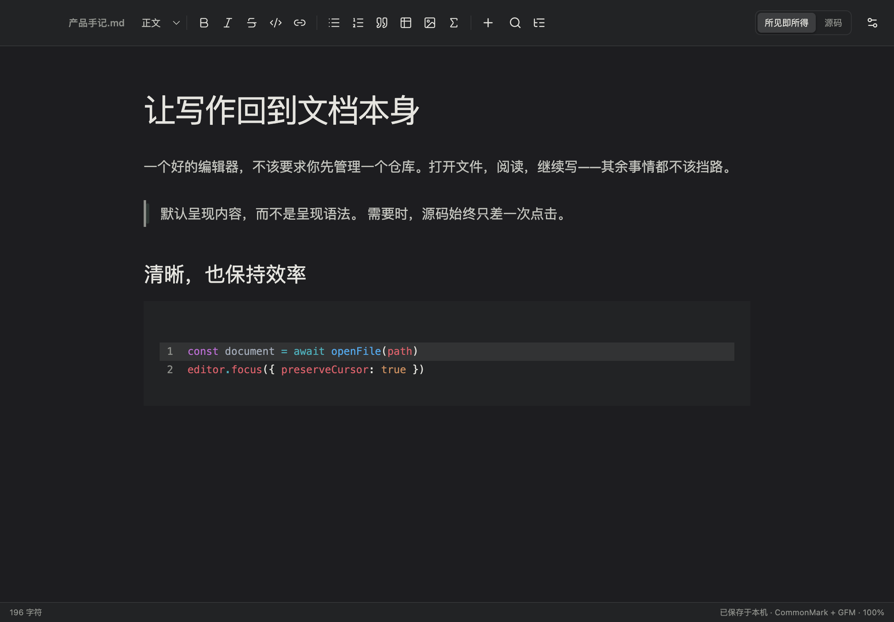

<p align="center">
  
</p>

<h1 align="center">Remark</h1>

<p align="center">
  <strong>文件优先的 macOS Markdown 阅读与编辑器</strong><br>
  打开文件，开始书写，没有其他干扰。
</p>

<p align="center">
  <a href="README.md">English</a> · <strong>简体中文</strong>
</p>

Remark 直接打开本地 Markdown 文件，不需要 Vault、工作区导入、账号或文件管理器。默认就是真正的所见即所得编辑器，一键即可切换完整源码编辑。

| 原生浅色 | 原生深色 |
| --- | --- |
|  |  |

## 下载

**系统要求：** macOS 13 Ventura 或更高版本。

请选择与你的 Mac 匹配的安装包。点击 **苹果菜单  > 关于本机**，查看 **芯片** 信息。

| 你的 Mac | 安装包 |
| --- | --- |
| Apple Silicon（M1 及更新芯片） | `Remark-<version>-unsigned-arm64.dmg` |
| Intel | `Remark-<version>-unsigned-x64.dmg` |

1. 在本仓库 Releases 页面下载并打开 DMG 文件。
2. 将 **Remark** 拖入 **应用程序**。
3. 启动 Remark，打开 `.md`、`.markdown`、`.mdown` 或 `.mkd` 文件。

> **预发布说明：** 当前安装包使用 ad-hoc 签名，没有 Apple Developer ID 签名，也未经公证。安装前请阅读发布说明并核对校验和。不要关闭 Gatekeeper 或降低系统安全设置。正式签名、公证版本会在发布说明中明确区分。

### 校验下载文件

将 DMG 和 `SHA256SUMS.txt` 放在同一目录，然后执行：

```bash
shasum -a 256 -c SHA256SUMS.txt
```

每一项检查结果都应以 `OK` 结尾。

## 快速开始

- **打开文档：** 使用 `⌘O`、Finder、Dock 拖入，或把文件拖到 Remark 窗口。
- **直接编辑：** 标题、列表、引用、表格、代码和公式等内容直接呈现，不显示 Markdown 标记。
- **切换源码：** 点击 **源码 / Source** 编辑原始 Markdown 文本。未保存内容会跟随你切换模式。
- **保存：** 按 `⌘S`，另存为按 `⇧⌘S`。默认手动保存，也可在设置中开启自动保存。
- **处理多份文件：** 默认使用 macOS 原生标签页。通过窗口菜单或原生标签操作，将标签拖成独立窗口或合并窗口。

| 操作 | 快捷键 |
| --- | --- |
| 新建文档 | `⌘N` |
| 新建标签 | `⌘T` |
| 打开文件 | `⌘O` |
| 保存 | `⌘S` |
| 另存为 | `⇧⌘S` |
| 查找和替换 | `⌘F` |
| 撤销 | `⌘Z` |
| 重做 | `⇧⌘Z` |
| 设置 | `⌘,` |

## 功能

### 文件优先，没有额外负担

- 所见即所得与源码编辑共享未保存内容，支持跨模式撤销检查点。
- macOS 原生标签页、独立窗口、最近文件和同文件去重。
- 当前文档查找替换，以及标题大纲导航。
- 手动保存、可选自动保存、关闭保护、崩溃恢复和外部修改冲突处理。

### 技术 Markdown

- CommonMark 与 GFM，包括表格、任务列表、删除线和代码高亮。
- 脚注、KaTeX 行内与块级公式。
- Mermaid 图表，可在源码模式编辑图表文本。
- 原始 HTML 经净化后预览，同时保留原始标记。
- 本地与远程图片、相对路径，以及导入图片到文档旁的 `assets` 目录。

### 按你的习惯调整

- 原生、GitHub、Solarized、Nord 四套主题，每套都有浅色和深色变体。
- 跟随系统、固定浅色或固定深色。
- 字体、字号、正文宽度、行高和状态栏设置。
- 默认编辑模式、标签页与窗口打开方式设置。

## 隐私与文件安全

Remark 不需要账号，也不包含分析统计或遥测。文档始终保存在本机，除非你主动打开远程内容或链接；这些操作可能访问外部服务器。

- **原子保存：** 先写入文档旁的临时文件，成功后再原子替换，避免写坏原文件。
- **冲突保护：** 其他应用修改同一文件时，不会静默覆盖任何一个版本。
- **恢复快照：** 未保存内容存放在应用本地的 Application Support 恢复目录，成功保存或干净关闭后删除。
- **资源约束：** 相对图片不能逃逸文档目录；绝对图片路径必须由用户明确选择授权。
- **不可信标记：** 原始 HTML 经过净化；Mermaid 使用 strict 模式并净化 SVG，文档脚本不会执行。

详见[安全说明](SECURITY.md)与漏洞报告方式。

## 从源码运行

**环境要求：** macOS 13+、Node.js 24+、npm 和 Xcode Command Line Tools，无需完整 Xcode。

```bash
npm ci
npm run dev
```

执行标准检查：

```bash
npm run typecheck
npm run lint
npm test
npm run test:e2e
npm run build
```

构建安装包并验证打包应用：

```bash
npm run dist:mac:unsigned   # Apple Silicon
npm run dist:mac:x64        # Intel
npm run smoke:packaged      # 在打包后的 arm64 应用中打开、编辑和保存
npm run checksums
```

安装包输出到 `release/`。签名、公证与发布流程见[维护者发布指南](docs/RELEASING.md)。

### 技术概览

Remark 使用 Electron、React 和 TypeScript。Milkdown/ProseMirror 负责所见即所得，CodeMirror 6 负责源码编辑；共享 `DocumentSession` 管理未保存 Markdown、脏状态和模式切换历史。渲染进程通过沙箱隔离、带类型约束的 IPC 访问文件和原生资源。

## 项目状态与限制

Remark 仍处于早期开发阶段，请先在自己的文档副本上试用。

- 当前 DMG 是未签名预发布包，尚未完成 Apple 公证和稳定版 Gatekeeper 验证。
- 富文本编辑可能规范化部分 Markdown 写法。未知 HTML 和扩展语法通过不透明节点保留，但富文本编辑后不承诺逐字节不变。
- `@milkdown/plugin-diagram` 已被上游标记为 deprecated，目前固定版本并覆盖 Mermaid 渲染测试，后续优先替换为维护中的适配器。
- 本版本不包含双栏、云同步、协作、插件系统、AI、自定义主题文件、自动更新或 App Store 上架。
- 当前仅面向 macOS，尚未提供 Windows 和 Linux 安装包。
- 当前应用界面为简体中文，英文界面仍在规划中；提供英文文档不代表已完成英文界面。

## 文档与许可证

- [Contributing](CONTRIBUTING.md) · [中文贡献指南](CONTRIBUTING.zh-CN.md)
- [Security](SECURITY.md) · [中文安全说明](SECURITY.zh-CN.md)
- [维护者发布指南](docs/RELEASING.md)
- [更新日志](CHANGELOG.md)
- [第三方组件声明](NOTICE.md)

Remark 采用 [GNU General Public License v3.0](LICENSE) 开源。
