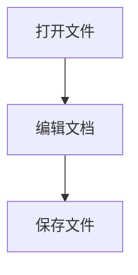

# 技术文档

GFM 支持 ~~删除线~~、任务列表和表格。

- [x] 已完成项目
- [ ] 待办项目

| 模块 | 状态 |
| --- | --- |
| Editor | Ready |

这是一个脚注引用[^note]。

[^note]: 脚注内容会显示在文档中。

行内公式 $E = mc^2$，以及块级公式：

$$
\int_0^1 x^2\,dx = \frac{1}{3}
$$



```ts
const mode: 'visual' | 'source' = 'visual'
```

<div class="notice"><strong>安全 HTML</strong></div>
<span data-type="html"><em>行内 HTML</em></span>
<script>window.__remarkUnsafe = true</script>

[安全链接](https://example.com)
